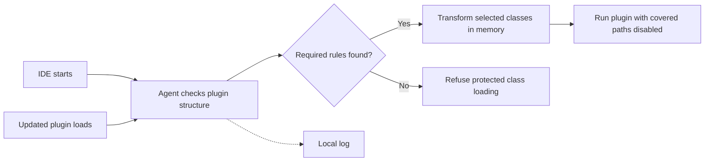

<p align="center">
  
</p>

<p align="center">
  <strong>Java 25</strong> · <strong>Python 3.11+</strong> · <strong>Zero runtime dependencies</strong> · <strong>MIT</strong>
</p>

<p align="center">
  English · <a href="README.ru.md">Русский</a> · <a href="docs/compatibility.md">Compatibility</a> · <a href="docs/architecture.md">How it works</a> · <a href="docs/installation.md#recovery">Recovery</a>
</p>

# Your IDE. Your privacy settings.

[](https://github.com/perkthefox/jetbrains-privacy-guard/actions/workflows/ci.yml)

JetBrains Privacy Guard is a local Java startup agent that disables **specific, inspected telemetry and environment-inspection paths** in supported IDE plugins. It transforms their bytecode in memory before the affected classes execute.

Keep Copilot, AI Assistant and Junie enabled. Suppress the extra analytics paths covered by the rules. Reapply those rules when updated plugin classes load.

**Experimental.** The real-IDE baseline is WebStorm 2026.2.3 on macOS with JetBrains Runtime 25. Other IDEs and versions need verification. AI features still send the requests and context needed to operate; this is targeted instrumentation, not a network sandbox.

## What it covers

| Component | Covered behavior |
| --- | --- |
| Extra Icons / Extra ToolWindow Colorful Icons | Known environment and agent scans, IDE statistics, remote inspection definitions and associated browser callbacks |
| Rainbow Brackets | Known JVM argument, class/resource and installed-plugin inspection paths |
| Material Theme UI | Analytics initialization, identification and tracking |
| GitHub Copilot | Telemetry and error upload paths, native telemetry setting, selected telemetry hosts in the IDE HTTP bridge |
| JetBrains AI Assistant | Additional data sharing, JCP analytics, agent-event telemetry and telemetry exporters |
| Junie | The inspected analytics producer |
| Other JVM plugin classes | Direct calls to `RuntimeMXBean.getInputArguments()` return an empty list |

Exact plugin versions and the limits of each claim are in the [compatibility table](docs/compatibility.md).

## Quick start

You need **JDK 25** and **Python 3.11+**. There is no Maven, Gradle or pip dependency download. Run these commands from the repository directory:

```sh
export JAVA_HOME="/path/to/jdk-25"
python3 scripts/project.py test
python3 scripts/project.py check
```

Preview the changes for a macOS WebStorm installation:

```sh
python3 guard.py install --ide-home "/Applications/WebStorm.app" --dry-run
```

Close WebStorm normally, then install:

```sh
python3 guard.py install --ide-home "/Applications/WebStorm.app"
```

Start WebStorm and inspect the installation:

```sh
python3 guard.py status
```

`status` reports configuration for the next start and the agent checksum. The local log records what happened in a running IDE. See [installation](docs/installation.md) for Toolbox paths, custom profiles, Linux, offline verification and recovery.

## How it works



- **Local by design.** The agent has no network client or remote rule updates.
- **Original plugin archives.** The agent does not rewrite installed plugin JARs.
- **Bounded rules.** Method signatures, call patterns and selected fields identify the inspected behavior. Names alone are not enough for every rule.
- **Conservative failure.** Missing required rules or a failed transformation prevent affected protected classes from loading. A plugin error may appear in the IDE.
- **Reversible installation.** Configuration backups are kept, existing Java agents are preserved, and rollback retains unrelated later edits.

See [architecture and rule design](docs/architecture.md) for implementation details.

## What remains outside the guarantee

New telemetry mechanisms, indirect/reflection-based inspection, native code outside the covered Copilot bridge and unsupported plugins require new investigation. A successful preflight means the required patterns were recognized; it does not prove a plugin can never send data.

The broad JVM-argument rule can also affect legitimate plugin diagnostics. Core JVM callers outside plugin scope are unchanged. License activation is outside this project's scope; the repository contains no keys, activation patches or vendor binaries.

## Disable or roll back

Close the IDE first:

```sh
# Remove the startup hook; keep explicit privacy opt-outs.
python3 guard.py disable

# Restore this installation's settings; keep backups and unrelated edits.
python3 guard.py rollback
```

If the agent prevents startup, these commands work without launching the IDE. [Recovery instructions](docs/installation.md#recovery) also cover manual removal of its single VM-options line.

## Development

```sh
python3 scripts/project.py build     # Compile a deterministic JAR
python3 scripts/project.py test      # JVM fixtures + installer regression tests
python3 scripts/project.py check     # Public-file and local-link checks
python3 scripts/project.py package   # ZIP + SHA-256 sidecar in dist/
```

The tests use original synthetic fixtures and make no HTTP requests. Real plugin scans are explicit and stay local. GitHub Actions is configured for macOS and Linux; a workflow result is separate from real-IDE compatibility.

[Contributing](CONTRIBUTING.md) · [Security](SECURITY.md) · [Changelog](CHANGELOG.md) · [Release guide](docs/releasing.md)

## License

[MIT](LICENSE). Independent project; not affiliated with or endorsed by JetBrains, GitHub, Microsoft or the plugin authors. Product names identify the components the rules target.
