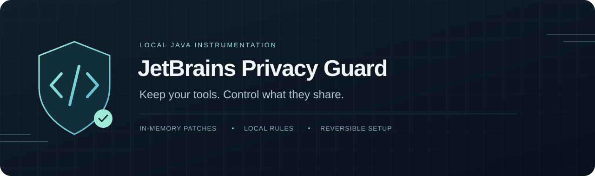

<p align="center">
  
</p>

<p align="center">
  <strong>Java 25</strong> · <strong>Python 3.11+</strong> · <strong>Без внешних зависимостей</strong> · <strong>MIT</strong>
</p>

<p align="center">
  <a href="README.md">English</a> · Русский · <a href="docs/compatibility.md">Совместимость</a> · <a href="docs/architecture.md">Устройство</a> · <a href="docs/installation.md#recovery">Восстановление</a>
</p>

# Твоя IDE. Твои настройки приватности.

[](https://github.com/perkthefox/jetbrains-privacy-guard/actions/workflows/ci.yml)

JetBrains Privacy Guard — локальный Java-агент, который блокирует **известные проверки на «кряки», Java-агенты и локальные модификации**, а также исследованные механизмы телеметрии и проверки окружения в поддерживаемых плагинах. Он меняет выбранные методы в памяти, до их выполнения.

Copilot, AI Assistant и Junie остаются включёнными. Правила закрывают дополнительную аналитику и применяются заново при загрузке обновлённых плагинов.

## Наша позиция: твоя IDE — твои правила

**Как ты запускаешь свою IDE и что в неё устанавливаешь — твоё дело. Авторов плагинов не должно волновать, какие у тебя параметры JVM, Java-агенты, плагины, локальные патчи или инструменты, которые они называют «кряками» и «взломами».**

Мы против таких проверок, сбора их результатов и отправки этих сведений куда-либо. Блокировка проверок на «кряки», «агенты», «взломы» и другие локальные модификации — прямая цель проекта: мы стремимся устранять каждый обнаруженный механизм такого рода.

**Что уже реализовано:** агент блокирует исследованные механизмы в поддерживаемых версиях плагинов. «Все возможные проверки» — цель, а не подтверждённая возможность: неизвестные способы, новые ветки кода и native-реализации требуют дополнительного анализа и правил.

**Экспериментальный проект.** Проверенная среда — WebStorm 2026.2.3 на macOS с JetBrains Runtime 25. Другие IDE и версии требуют проверки. Рабочие функции AI по-прежнему передают запросы и нужный им контекст провайдерам. Агент не обеспечивает сетевую изоляцию всей IDE.

## Что отключается

| Компонент | Покрытые механизмы |
| --- | --- |
| Extra Icons / Extra ToolWindow Colorful Icons | Найденные проверки на «кряки» и Java-агенты, проверки окружения, статистика IDE, удалённые определения проверок и связанные обработчики открытия браузера |
| Rainbow Brackets | Найденные проверки на «кряки» и агенты через аргументы JVM, поиск классов и ресурсов, список установленных плагинов |
| Material Theme UI | Инициализация аналитики, идентификация и отправка событий |
| GitHub Copilot | Телеметрия и отправка ошибок, настройка native-сервера, известные адреса аналитики в HTTP-мосте IDE |
| JetBrains AI Assistant | Дополнительный обмен данными, JCP-аналитика, события агента и экспорт телеметрии |
| Junie | Исследованный отправщик аналитических событий |
| Другие JVM-плагины | Прямые вызовы `RuntimeMXBean.getInputArguments()` получают пустой список |

Версии и границы проверки перечислены в [таблице совместимости](docs/compatibility.md).

## Быстрый старт

Нужны **JDK 25** и **Python 3.11+**. Maven, Gradle и пакеты из pip не требуются. Из каталога репозитория:

```sh
export JAVA_HOME="/path/to/jdk-25"
python3 scripts/project.py test
python3 scripts/project.py check
```

Посмотреть будущие изменения для WebStorm на macOS:

```sh
python3 guard.py install --ide-home "/Applications/WebStorm.app" --dry-run
```

Нормально закрыть WebStorm и установить агент:

```sh
python3 guard.py install --ide-home "/Applications/WebStorm.app"
```

После запуска IDE:

```sh
python3 guard.py status
```

Команда показывает настройки следующего запуска и проверяет хеш агента. Реально выполненные преобразования записываются в локальный журнал. Пути Toolbox, собственные профили, Linux и проверка без установки описаны в [инструкции](docs/installation.md).

## Как работает

1. Запускается вместе с JVM через `-javaagent`.
2. Проверяет структуру поддерживаемых плагинов и наличие обязательных правил.
3. При загрузке классов подменяет конкретные методы и вызовы в памяти.
4. При появлении изменённого JAR повторяет проверку. Если обязательные правила не распознаны, блокирует загрузку защищаемых классов и пишет причину в журнал.

Сам агент не переписывает JAR плагинов на диске, ничего не отправляет в сеть и не скачивает правила. Установщик сохраняет резервные копии, существующие Java-агенты и посторонние настройки.

Подробнее: [архитектура и правила](docs/architecture.md).

## Границы защиты

Совершенно новая телеметрия, косвенные вызовы через reflection, сторонний native-код и неподдерживаемые плагины требуют отдельного аудита. Успешная проверка подтверждает распознавание обязательных шаблонов, а не отсутствие любых возможных сетевых отправок.

Общее скрытие аргументов JVM может затронуть и обычную диагностику плагинов. Вызовы из ядра JVM вне плагинов не меняются. Активация лицензий в задачи проекта не входит; ключей, патчей активации и бинарников чужих плагинов в репозитории нет.

## Отключение и откат

Сначала закрыть IDE:

```sh
# Отключить агент, сохранив явные настройки отказа от телеметрии.
python3 guard.py disable

# Откатить настройки установки, сохранив резервные копии и посторонние изменения.
python3 guard.py rollback
```

IDE для этих команд запускать не нужно. Если она не стартует, есть [инструкция восстановления](docs/installation.md#recovery), включая ручное удаление единственной строки агента из VM options.

## Разработка

```sh
python3 scripts/project.py build
python3 scripts/project.py test
python3 scripts/project.py check
python3 scripts/project.py package
```

Тесты работают с собственными искусственными плагинами и не делают HTTP-запросов. Проверка настоящих плагинов запускается отдельно и сохраняет результаты локально. CI настроен для macOS и Linux; прохождение CI само по себе не подтверждает совместимость с реальной IDE.

[Участие в разработке](CONTRIBUTING.md) · [Безопасность](SECURITY.md) · [Изменения](CHANGELOG.md) · [Подготовка релиза](docs/releasing.md)

## Лицензия

[MIT](LICENSE). Независимый проект, не связанный с JetBrains, GitHub, Microsoft или авторами плагинов. Названия продуктов используются для обозначения поддерживаемых компонентов.
